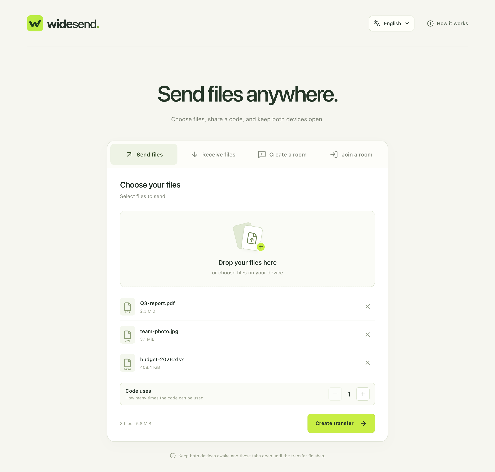
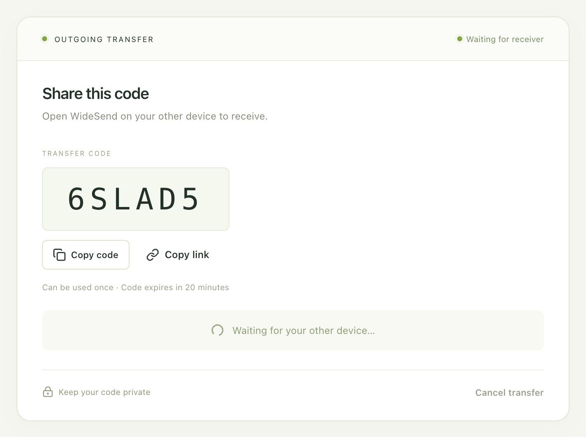
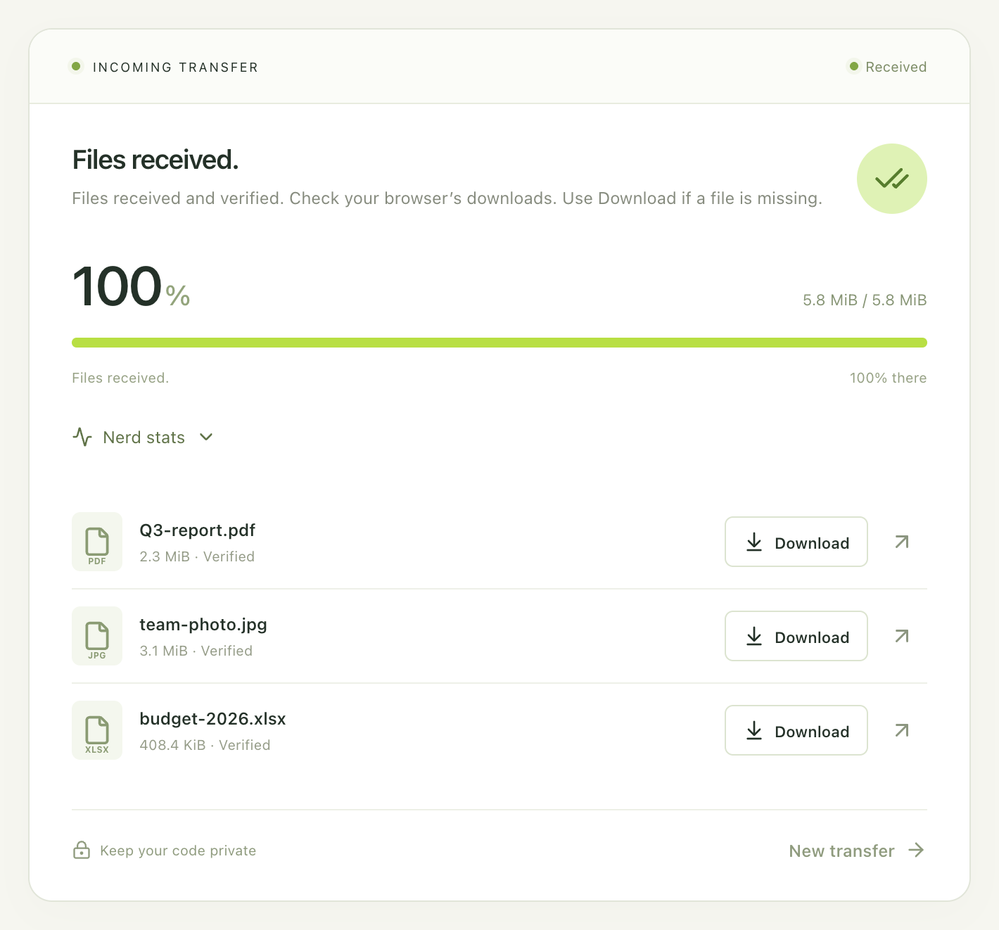
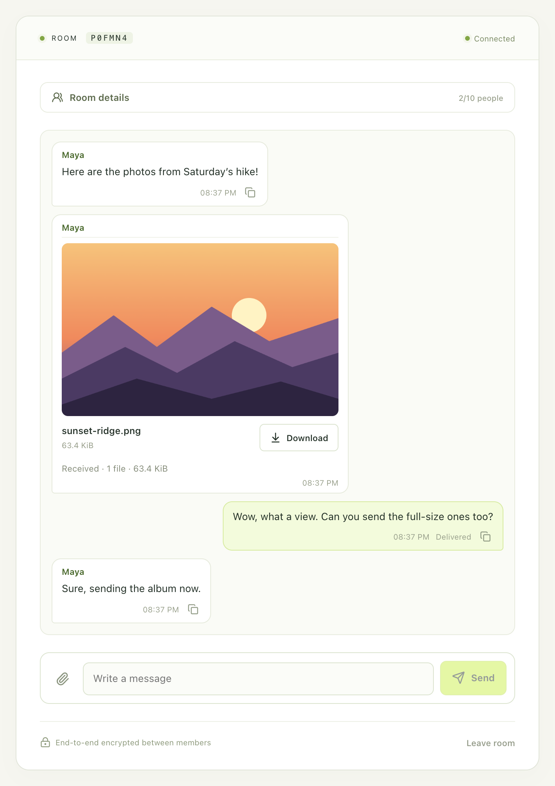
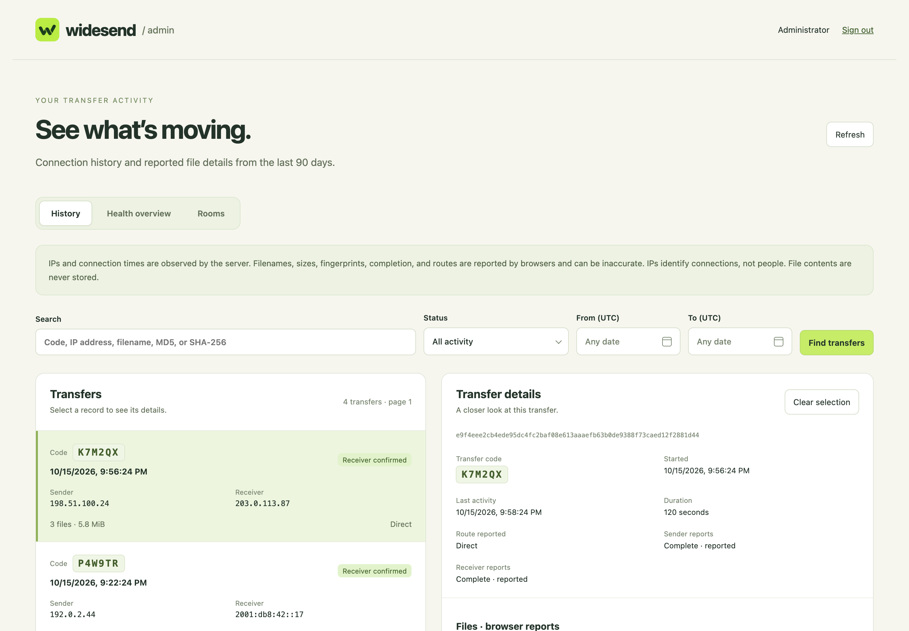

# WideSend

Private file transfers between desktop and mobile browsers, and from the command line: to
one person or several with one six-character code, or back and forth in a room. Files travel
directly between devices over WebRTC when they can, and through an encrypted relay when they
can't. Nothing is stored on the server, and there is no account to create.

**Try it at [widesend.app](https://widesend.app)**, a free public instance, or run your own
on Cloudflare's free plan in a few minutes. widesend.app keeps the 90-day
[activity record](#admin-dashboard-optional) described below; your own instance keeps none
unless you add the dashboard.

<p align="center">
  
</p>

## Features

- **Send files**: choose up to 100 files and share the code or a link. The code can be used
  up to 10 times, by different people or devices.
- **Rooms**: a conversation for two people or a group, with messages, images and files in
  one timeline, and settings for who can join and who can send.
- **Large files**: streamed to the receiver's disk, verified with SHA-256, resumed after a
  dropped connection, a reload or a browser restart, within 24 hours.
- **End-to-end encryption**: SPAKE2 turns the code into fresh keys on both devices; the server
  only ever relays ciphertext ([SECURITY.md](SECURITY.md)).
- **Command line**: `npx widesend send file` from a server over SSH to a phone.
- **Six languages**: English, Simplified Chinese, French, Spanish, Japanese and Korean.

<table>
  <tr>
    <td width="50%" valign="top">
      
      <p align="center"><sub>The sender shares a six-character code or a link.</sub></p>
      
      <p align="center"><sub>The receiver's browser checks every file before saving it.</sub></p>
    </td>
    <td width="50%" valign="top">
      
      <p align="center"><sub>A room: messages, pictures and files in one conversation.</sub></p>
    </td>
  </tr>
</table>

## Command line

```sh
npx widesend send report.pdf        # prints a code, a link and a QR code
npx widesend receive A1B2C3         # in another terminal, anywhere
npx widesend send -n 3 slides.pdf   # a code that can be used three times
npx widesend send report.pdf --server https://send.example.com   # your own instance
```

It runs this app's own transfer engine on Node.js, so browser and command-line transfers
work together. See [cli/README.md](cli/README.md).

## Run your own

[](https://deploy.workers.cloudflare.com/?url=https://github.com/qcheng-info/widesend)

The **Deploy to Cloudflare** button copies this repository to your GitHub or GitLab account
and deploys the site on workers.dev, without the admin dashboard. From a clone, the setup
command also offers a custom domain and the dashboard:

```sh
npm ci
npx wrangler login
npm run setup
```

On the free plan a site can relay about 98 GiB a day; direct transfers cost almost nothing.
See [docs/self-hosting.md](docs/self-hosting.md).

## Admin dashboard (optional)

The dashboard is a private website for whoever runs an instance, to answer questions like
"did my file arrive?" or "who is using my site?". It is a second Worker (`<name>-admin`),
on its own address, that reads an activity record kept in a D1 database:

- **History**: every transfer and room, with the IP addresses and countries of the devices
  that connected, the transfer code, file names, sizes and fingerprints as both browsers
  reported them, whether the receiver confirmed every byte, the route (direct or relay), and
  why each connection closed.
- **Health overview**: transfers and their outcomes, blocked attempts, and how much of the
  daily relay allowance has been used.
- **Rooms**: who joined and when, what was shared, and how many messages each person sent.

It never sees file or message contents, and records are deleted after 90 days.

<p align="center">
  
  <br><sub>The dashboard, with sample records.</sub>
</p>

**You can do without it.** Without the dashboard there is no database, and your site keeps
no record of transfers: its "How it works" panel tells visitors so. The Deploy button never
adds it. To add it later, run `npm run setup -- --admin` in a clone: it creates the
database and deploys the dashboard with a generated password, or behind Cloudflare Access.
`npm run setup -- --no-admin` stops recording again. See [docs/admin.md](docs/admin.md).

## Known limitations

- **Direct transfers from the command line** can slow to a few hundred KiB/s on long or
  lossy network paths: the WebRTC library it uses recovers slowly from packet loss. Browsers
  do better on the same paths, and `--relay` can be faster there (it uses the site's relay
  allowance).
- **A browser without enough storage** for the files tells its own user before anything is
  sent, but the sender isn't told and waits until the code expires (20 minutes).
- **Limits**: when a network has created too many transfers, the command line says "Server
  busy" and retries by itself, without saying which limit or for how long.
- **Large files** are read once before sending, to fingerprint them: for a few GiB, the
  receiver shows 0 % for a minute or two.
- **Phones** may pause a page in the background; keep it open until the transfer finishes.

## Documentation

| Document                               | Contents                                                     |
| -------------------------------------- | ------------------------------------------------------------ |
| [Using WideSend](docs/using.md)        | Sending, code uses, recovery, statistics, rooms, large files |
| [Self-hosting](docs/self-hosting.md)   | Deploying, domains, costs, updating, several instances       |
| [Configuration](docs/configuration.md) | Every setting, limit and binding                             |
| [Admin dashboard](docs/admin.md)       | What is recorded, signing in, the health overview            |
| [How it works](docs/how-it-works.md)   | Architecture, privacy, abuse protection, the relay budget    |
| [Security](SECURITY.md)                | The protocol, trust boundaries and their limits              |
| [Contributing](CONTRIBUTING.md)        | Before you open a pull request                               |
| [Command line](cli/README.md)          | The `widesend` command                                       |

## Privacy in brief

File contents never reach the server unencrypted, and are never stored there. The server
sees connection addresses and timing, and relays ciphertext when devices can't connect
directly. An instance with the [admin dashboard](#admin-dashboard-optional) keeps a 90-day
record of transfers and rooms for its operator: IP addresses and countries, transfer codes,
display names in rooms, file names (unless turned off), types, sizes and fingerprints, and
how many messages were sent, never file or message contents. Each site says what it records
in its "How it works" panel.

## License

Apache-2.0. See [LICENSE](LICENSE).
